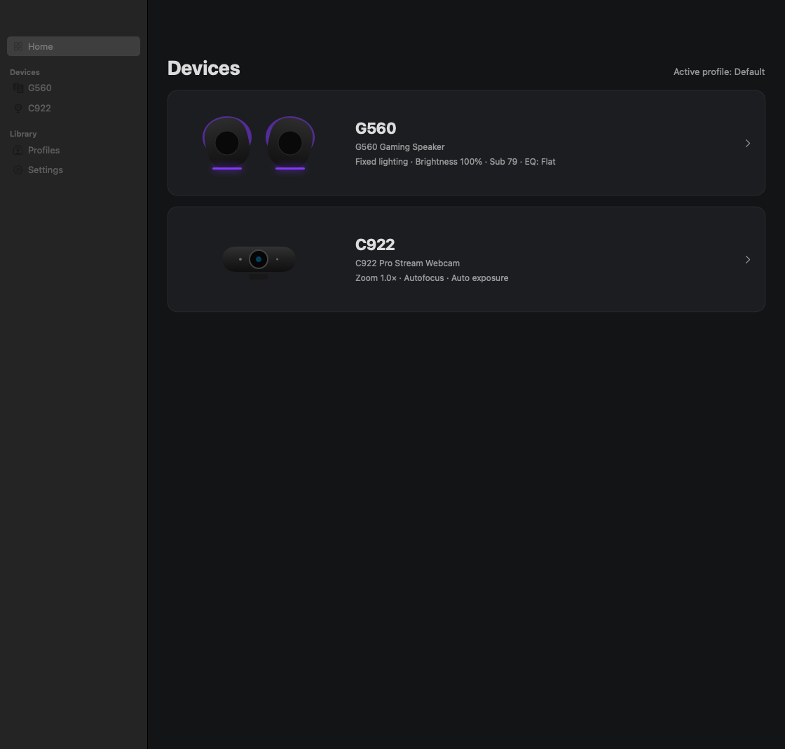

# Hubless

A small, local-only macOS replacement for Logitech G HUB's device management. It has no
account, no cloud sync, no community features, no game integrations and no telemetry.
It manages your devices and keeps settings in local profiles.



## Download

Get the latest **Hubless-x.y.z.zip** from [Releases](https://github.com/nicolasalbani/rea-logitech-ghub/releases/latest).
It's a universal app (Apple Silicon + Intel) for macOS 14 or later. Unzip it and drag **Hubless.app** to Applications.

The app is ad-hoc signed and not notarized, so macOS blocks it on first launch. Open it once, then go to
**System Settings › Privacy & Security** and click **Open Anyway**. Or run:

```bash
xattr -dr com.apple.quarantine /Applications/Hubless.app
```

## Supported devices

| Device | What you can control |
|--------|---------------------|
| **G560** speakers | Lighting for all 4 zones, synced or per zone: Off / Fixed color / Color cycle / Breathing / the device's onboard effect. Zones are named Front/Back Left/Right. Plus speed, intensity, global brightness, **system volume and mute**, **subwoofer level**, and the 10-band hardware EQ with presets |
| **C922** webcam | Zoom, pan/tilt, autofocus and focus, auto or manual exposure, low-light compensation, gain, auto or manual white balance, brightness, contrast, saturation, sharpness, backlight compensation, anti-flicker. Includes a live preview and a "restore defaults" button |

Devices are detected by capability, not hard-coded, so other Logitech HID++ lighting/EQ devices and UVC
webcams will generally work too.

## Profiles

- A profile stores the settings of every device (lighting, brightness, EQ, subwoofer level, camera image). System volume is live only, like the macOS volume keys.
- Edits apply to the **active** profile and are saved immediately.
- Create (copy of current, or from device defaults), duplicate, rename, delete, and import/export as JSON.
- Switch profiles from the toolbar or the **menu bar** icon. The app keeps running in the menu bar when the window is closed.
- Settings are re-applied when a device is plugged in, after the Mac wakes from sleep, and (optionally) when an app starts using the camera.
- Storage: `~/Library/Application Support/Hubless/profiles.json`.

## Build and run

Requires macOS 14+ and the Xcode command-line tools.

```bash
./scripts/build_app.sh          # -> build/Hubless.app (universal, ad-hoc signed) + build/Hubless-<version>.zip
ARCHS=arm64 ./scripts/build_app.sh   # faster single-architecture build
open build/Hubless.app
swift test                      # unit tests (protocol encoding, descriptor parsing, storage)
```

### Publishing a release

Push a version tag and the [Release workflow](.github/workflows/release.yml) tests, builds and publishes
the zip to GitHub Releases:

```bash
git tag v1.0.1 && git push origin v1.0.1
```

### Hardware verification modes

```bash
build/Hubless.app/Contents/MacOS/Hubless --diagnose   # print detected devices, ranges and state
build/Hubless.app/Contents/MacOS/Hubless --selftest   # switch to a temp profile, verify by read-back, restore
build/Hubless.app/Contents/MacOS/Hubless --snapshot docs/screenshots
```

## How it works

See [docs/PROTOCOL.md](docs/PROTOCOL.md) for the reverse-engineered protocols (HID++ 2.0 for the G560,
UVC class requests for the C922) and how REA was used on G HUB.

| Path | Contents |
|------|----------|
| `Sources/Hubless/HIDPP` | HID++ 2.0 transport, plus lighting / brightness / EQ codecs |
| `Sources/Hubless/UVC` | UVC descriptor parser and control transfers |
| `Sources/Hubless/Model` | discovery (IOHIDManager, IOKit USB notifications, CoreMediaIO), device controllers, profiles |
| `Sources/Hubless/UI` | SwiftUI interface |

Quit G HUB or Logi Options+ if installed, since they also write to the same devices.
